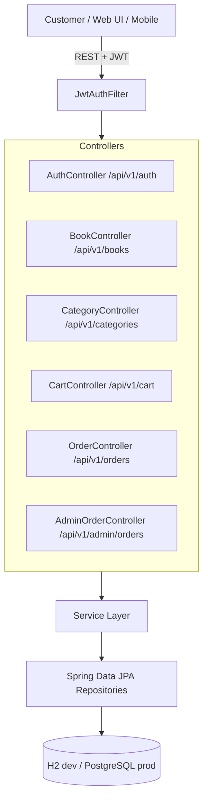

# PageTurner Bookstore: eCommerce Backend

A backend REST API for an eCommerce bookstore, built with **Java 21**, **Spring Boot 3.3.5**, **Spring Data JPA**, **Spring Security (JWT)**, and **H2 / PostgreSQL**.

---

## Architecture Overview



---

## API Endpoints

| Area | Method & Path | Access |
|:---|:---|:---|
| Auth | `POST /api/v1/auth/register`, `POST /api/v1/auth/login` | Public |
| Books | `GET /api/v1/books`, `GET /api/v1/books/{id}` | Public |
| Books | `POST`, `PUT /{id}`, `DELETE /{id}` on `/api/v1/books` | Admin |
| Categories | `GET /api/v1/categories`, `GET /api/v1/categories/{id}` | Public |
| Categories | `POST`, `PUT /{id}`, `DELETE /{id}` on `/api/v1/categories` | Admin |
| Cart | `GET /api/v1/cart`, `DELETE /api/v1/cart` | Authenticated |
| Cart | `POST /api/v1/cart/items`, `PUT`/`DELETE /api/v1/cart/items/{bookId}` | Authenticated |
| Orders | `POST /api/v1/orders`, `GET /api/v1/orders`, `GET /api/v1/orders/{id}` | Authenticated |
| Admin Orders | `GET /api/v1/admin/orders`, `PATCH /api/v1/admin/orders/{id}/status` | Admin |

---

## Project Structure

```
.
├── README.md
├── .gitignore
└── bookstore-backend/
    ├── pom.xml                              # Maven build & dependencies
    └── src/
        ├── main/
        │   ├── java/com/ibm/bookstore/
        │   │   ├── BookstoreApplication.java  # Spring Boot entry point
        │   │   ├── config/                    # SecurityConfig, DataSeeder
        │   │   ├── controller/                # REST controllers
        │   │   ├── dto/                       # Request/response DTOs
        │   │   ├── exception/                 # Custom exceptions & global handler
        │   │   ├── model/                     # JPA entities
        │   │   ├── repository/                # Spring Data repositories
        │   │   ├── security/                  # JWT filter & service
        │   │   └── service/                   # Business logic
        │   └── resources/
        │       ├── application.yaml           # Default (dev) configuration
        │       └── application-prod.yaml      # Production configuration
        └── test/                              # Tests
```

---

## Getting Started

### Prerequisites

- JDK 21
- Maven 3.9+

### 1. Build

```bash
cd bookstore-backend
mvn clean package
```

### 2. Run (development profile, in-memory H2)

```bash
mvn spring-boot:run
```

- API base URL: `http://127.0.0.1:8080/api/v1`
- H2 console (dev only): `http://127.0.0.1:8080/h2-console`
- Demo data (categories, books, and an admin user) is seeded automatically in non-`prod` profiles.

### 3. Run (production profile)

Set the following environment variables, then start with the `prod` profile:

| Variable | Purpose |
|:---|:---|
| `DATABASE_URL` | PostgreSQL JDBC URL |
| `DB_USERNAME` / `DB_PASSWORD` | Database credentials |
| `JWT_SECRET` | Base64-encoded 512-bit JWT signing secret (`openssl rand -base64 64`) |
| `JWT_EXPIRATION_MS` | Token lifetime (default `3600000`) |
| `SSL_KEYSTORE_PATH` / `SSL_KEYSTORE_PASSWORD` | PKCS12 keystore for TLS |
| `PORT` | Server port (default `8080`) |

```bash
mvn spring-boot:run -Dspring-boot.run.profiles=prod
```

### 4. Test

```bash
mvn test
```

---

## Security Compliance

- **Network Security**: Server binds exclusively to `127.0.0.1`; production profile enforces TLS 1.2/1.3.
- **Authentication**: Stateless JWT authentication with role-based access control (`ROLE_USER`, `ROLE_ADMIN`).
- **Password Storage**: BCrypt (strength 12).
- **Input Validation**: Bean Validation on request DTOs; centralized `GlobalExceptionHandler` returns generic errors.
- **Injection Defense**: Spring Data JPA parameterized queries.
- **Secrets Management**: Configuration via environment variables; the default dev JWT secret must be replaced in production.
