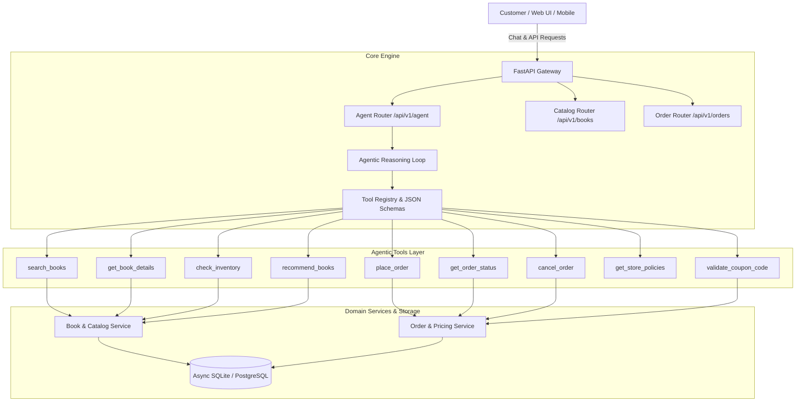

# PageTurner Bookstore: Agentic eCommerce Backend

A production-grade backend solution for an eCommerce bookstore utilizing **Agentic Tool-Calling Architecture**, built with **FastAPI**, **SQLAlchemy (Async)**, and **Pydantic v2**.

---

## Architecture Overview



---

## Agentic Tools Capabilities

The backend exposes self-describing Agentic Tools that can be dynamically discovered, validated, and executed by LLMs (OpenAI Function Calling, watsonx, Anthropic Tool Use, or MCP clients):

| Tool Name | Purpose | Key Parameters |
|:---|:---|:---|
| `search_books` | Semantic & filtered catalog search | `query`, `category`, `max_price`, `min_rating`, `in_stock_only` |
| `get_book_details` | Full book metadata & ISBN lookup | `book_id` |
| `check_inventory` | Real-time stock verification | `book_id` |
| `place_order` | Validates stock, calculates totals, applies coupons, deducts inventory | `customer_email`, `customer_name`, `shipping_address`, `items`, `coupon_code` |
| `get_order_status` | Real-time order fulfillment & shipment tracking | `order_id` |
| `get_customer_orders` | Customer order history lookup | `customer_email` |
| `cancel_order` | Cancels unfulfilled orders and restores inventory | `order_id` |
| `recommend_books` | Topic and interest-based book recommendations | `topic_or_genre`, `max_budget`, `limit` |
| `find_similar_books` | Category & thematic similarity recommendation | `book_id`, `limit` |
| `get_store_policies` | Knowledge lookup for shipping, returns, refunds, digital delivery | `topic` |
| `validate_coupon_code` | Promo code validation and discount calculation | `coupon_code` |

---

## Project Structure

```
.
├── Dockerfile                   # Red Hat UBI minimal container definition
├── pyproject.toml               # Modern build & dependency config
├── requirements.txt             # Pinned package versions
├── .env.example                 # Environment configuration template
├── .gitignore                   # Version control exclusions
├── src/
│   ├── main.py                  # FastAPI entry point & lifespan handler
│   ├── config.py                # Pydantic Settings & environment variables
│   ├── database.py              # Async SQLAlchemy engine & session factory
│   ├── models/                  # Database models (Book, Order, OrderItem, User)
│   ├── schemas/                 # Pydantic models (DTOs, Tool Schemas, Chat)
│   ├── tools/                   # Agentic Tools and Central Tool Registry
│   ├── agent/                   # Agent Reasoning Loop & Tool Orchestrator
│   ├── services/                # Business logic (BookService, OrderService)
│   └── routers/                 # API endpoints (books, orders, agent)
└── tests/                       # Async test suite
```

---

## Getting Started

### 1. Installation

```bash
# Create and activate virtual environment
python -m venv .venv
source .venv/bin/activate  # On Windows: .venv\Scripts\activate

# Install dependencies
pip install -r requirements.txt
```

### 2. Configuration

Copy the sample environment file:
```bash
cp .env.example .env
```

### 3. Run Application

```bash
uvicorn src.main:app --host 127.0.0.1 --port 8000 --reload
```

- Swagger UI API Docs: `http://127.0.0.1:8000/docs`
- OpenAPI Specification: `http://127.0.0.1:8000/openapi.json`
- Healthcheck: `http://127.0.0.1:8000/health`

---

## Example Agent Request

### Conversational Query via `/api/v1/agent/chat`

```bash
curl -X POST "http://127.0.0.1:8000/api/v1/agent/chat" \
     -H "Content-Type: application/json" \
     -d '{
       "messages": [
         {"role": "user", "content": "I am looking for books on distributed data systems and want to know your return policy."}
       ],
       "max_steps": 5
     }'
```

---

## Security Compliance

- **Network Security**: Server binds exclusively to `127.0.0.1` / `localhost`.
- **Input Sanitization**: Strict Pydantic v2 schemas reject malformed payloads.
- **ORM & Injection Defense**: Parameterized SQLAlchemy ORM queries prevent SQL injection.
- **Container Compliance**: Multi-stage Red Hat UBI minimal base image with non-root user execution (`UID 1001`).
- **Secrets Management**: Configuration via environment variables; secrets never logged or committed.
